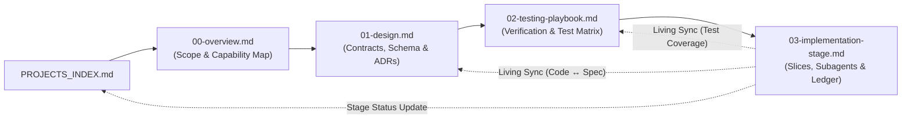

# Living Spec Trees & Project Portfolio Skill

Every project is driven by a **Hierarchical Living Spec Tree** rather than a monolithic document or ad-hoc chat history (synthesized from `addyosmani/agent-skills` Capability Maps & ADRs and `obra/superpowers` Subagent Implementation Plans).

---

## 1. Portfolio Index & Spec Tree Topology

All projects are indexed in **[PROJECTS_INDEX.md](../../specs/PROJECTS_INDEX.md)** (`/Users/nitroi/.gemini/config/plugins/agentic-dev/specs/PROJECTS_INDEX.md`), with each project's living specification tree stored under `specs/projects/<project-slug>/` (and optionally mirrored in `<project-workspace>/specs/`):

```text
specs/
├── PROJECTS_INDEX.md                     # Master Portfolio Index of all projects & current stages
├── _template/                            # Canonical stage templates
└── projects/
    └── <project-slug>/
        ├── 00-overview.md                # Stage 1: Vision, Objectives, Assumptions, Capability Map (Module Tree), Boundaries
        ├── 01-design.md                  # Stage 2: Architecture, Domain Model, Kotlin/TS API Contracts, ADRs, Diagrams
        ├── 02-testing-playbook.md        # Stage 3: Verification Matrix, Test Cases (Unit, Slice, Testcontainers, UI/Mobile)
        ├── 03-implementation-stage.md    # Stage 4: Disjoint Vertical Slices, Model Tier Routing, Live Checkboxes, Rulings Ledger
        └── modules/                      # Child spec nodes for multi-capability projects (Progressive Disclosure)
            └── <module-id>/
                ├── spec.md               # Module-specific contracts, data model & acceptance criteria
                └── tasks.md              # Module-specific implementation slices & test checklist
```

### Why a Tree of Specs? (Token Optimization)
- **Progressive Disclosure**: Agents load `PROJECTS_INDEX.md` and `00-overview.md` first, then read *only* the specific stage file (`01-design.md`, `02-testing-playbook.md`, `03-implementation-stage.md`) or child `modules/<module-id>/spec.md` needed for the current task.
- **Subagent Isolation**: When dispatching a worker subagent (`flash_lite` / `flash` / `pro`), pass only the relevant module spec and testing playbook excerpt.

---

## 2. The 4-Stage Living Spec Lifecycle



### Stage 1: `00-overview.md` — Overview & Capability Map
1. **Objective & Reframed Success Criteria**: Translate goals into measurable, testable outcomes (e.g., latency, UX flows, platform targets).
2. **Explicit Assumptions**: List assumptions upfront so the user can validate or correct them immediately.
3. **Capability Map (Tree Decomposition)**:
   - When a project spans multiple independently testable capabilities (e.g., `auth`, `catalog`, `checkout`, `notifications`), define a **Capability Map** table with:
     - Stable kebab-case `module-id`
     - Responsibility & boundaries
     - One-way dependency graph (`Depends on`) and build order
   - Each module in the map gets its own child node under `modules/<module-id>/spec.md`.
4. **Three-Tier Boundaries**:
   - **Always**: Run tests before commit, keep DTOs/interfaces synced, update living spec.
   - **Ask First**: Schema breaking changes, new external dependencies, auth/security changes.
   - **Never**: Hardcode secrets, bypass validation, delete failing tests.
5. **Out of Scope (Deferred V2 Backlog)**: Explicitly capture deferred ideas so scope never creeps silently.

### Stage 2: `01-design.md` — Architecture, Contracts & ADRs
1. **System & Component Architecture**: Mermaid diagrams covering Backend (`Kotlin` + `Spring Boot`), Web (`Angular` / `React`), and Mobile (`React Native` + `Kotlin`).
2. **Data Model & Persistence**: Entity relationships, Flyway migrations, indexes, and caching strategy.
3. **Cross-Layer API Contracts**: Exact REST endpoints, Kotlin `data class` / `@JvmInline value class` DTOs, TypeScript interfaces, and RFC 9457 `ProblemDetail` error codes.
4. **Architecture Decision Records (ADRs)**: Concise `Context → Decision → Consequences` logs for major technical choices.

### Stage 3: `02-testing-playbook.md` — Testing Playbook & Verification Matrix
1. **Backend Verification Plan**:
   - Unit tests (JUnit 5 + MockK) for domain/service rules.
   - Web slice tests (`@WebMvcTest`) for validation, serialization, and auth guards.
   - Persistence slice tests (`@DataJpaTest` + Testcontainers) for queries/migrations.
   - ArchUnit rules for module/layer boundaries.
2. **Web & Mobile Verification Plan**:
   - Component & Hook tests (Vitest / Jest + React Testing Library / Angular `TestBed`).
   - Mobile device/simulator checks (Safe Areas, `FlashList` 60fps scroll, offline cache recovery, iOS + Android navigation).
3. **Edge-Case & Failure Matrix**: Specific inputs, boundary values, concurrency races, and network failure scenarios that must be tested.

### Stage 4: `03-implementation-stage.md` — Implementation Plan & Living Ledger
1. **Vertical Slice Task Breakdown**:
   - Order tasks bottom-up by dependency and slice vertically (delivering testable end-to-end increments).
   - Every task specifies: **Target Files**, **Subagent & Model Tier (`flash_lite` / `flash` / `pro`)**, **Verification Command**, and **Status Checkbox (`- [ ]` / `- [x]`)**.
2. **Rulings & Drift Ledger**:
   - Record implementation decisions as `Ruling: <decision> — <reason> — <impact>`.
   - Whenever implementation reveals a needed API or design adjustment, immediately back-propagate the change to `01-design.md` and `02-testing-playbook.md`.

---

## 3. Scaffolding & GitHub Sync Commands

### Initialize a New Project Spec Tree
Run the helper script to scaffold a new project from the canonical templates, register it in `specs/PROJECTS_INDEX.md`, and push to GitHub:

```bash
/Users/nitroi/.gemini/config/plugins/agentic-dev/scripts/init-project-spec.sh <project-slug> "<Project Name>" "<Tech Stack>"
```

### Continuous Living Spec Sync Protocol
Whenever you complete a design phase, update a testing playbook, check off an implementation slice, or adjust an API contract:
1. Update the relevant file(s) in `specs/projects/<project-slug>/` and update the project's stage/status in `specs/PROJECTS_INDEX.md`.
2. Run `/Users/nitroi/.gemini/config/plugins/agentic-dev/scripts/sync-to-github.sh "docs(spec): update <project-slug> living spec"` to commit and push to GitHub.
