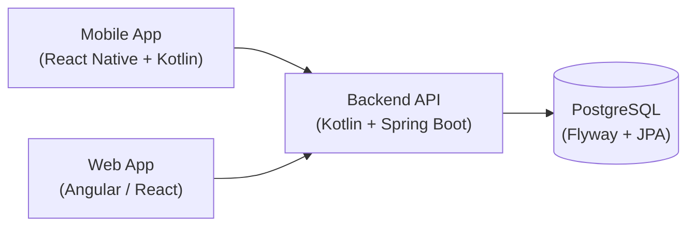

# {{PROJECT_NAME}} — Stage 2: Architecture, Contracts & ADRs

- **Project Slug:** `{{PROJECT_SLUG}}`
- **Parent Spec:** [00-overview.md](./00-overview.md)
- **Last Updated:** {{DATE}}

---

## 1. System Architecture



## 2. Domain Model & Database Schema (`Flyway`)

- **Value Objects (`@JvmInline value class`):**
- **Entities & Tables:**
- **Migrations (`db/migration/V*__*.sql`):**

## 3. Cross-Layer API Contracts

### Endpoint: `POST /api/v1/...`
- **Kotlin Request DTO (`@Valid`):**
  ```kotlin
  data class ExampleRequest(
      @field:NotBlank val name: String
  )
  ```
- **TypeScript Client Interface (Web & Mobile):**
  ```ts
  export interface ExampleRequest {
    readonly name: string;
  }
  ```
- **Error Responses (`RFC 9457 ProblemDetail`):**
  - `400 Bad Request` — Validation errors
  - `401 / 403` — Unauthorized / Forbidden
  - `404 Not Found` — Resource missing

## 4. Client State & UI Architecture

- **Web (`Angular` Signals / `React` TanStack Query):**
- **Mobile (`React Native` Navigation, Safe Areas, `FlashList`, Offline Cache):**

## 5. Architecture Decision Records (ADRs)

### ADR-001: [Decision Title]
- **Status:** Accepted ({{DATE}})
- **Context:** [Why was a decision needed?]
- **Decision:** [What did we choose?]
- **Consequences:** [Trade-offs and follow-ups]
