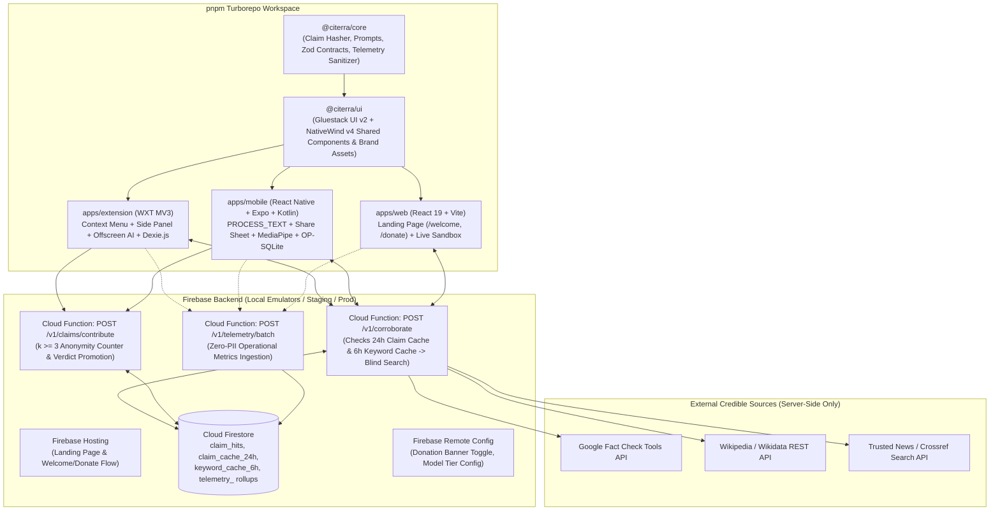

# Citerra — Stage 2: Architecture, Contracts & ADRs

- **Project Slug:** `citerra`
- **Parent Spec:** [00-overview.md](./00-overview.md)
- **Last Updated:** 2026-11-15

---

## 1. System Architecture



---

## 2. Firestore Data Model & Two-Tier TTL Cache Schema

> **Security Rule Invariant:** All Firestore collections are **locked to Admin SDK / Cloud Functions only** (`allow read, write: if false;` for direct client SDK access, except optional public read on aggregated non-PII stats). All client interactions go through rate-limited, Zod-validated Cloud Functions v2.

### Collection 1: `claim_hits/{claimHash}` (k-Anonymity Gatekeeper)
Tracks lookup frequency for normalized claim SHA-256 hashes without storing any text until `hitCount >= 3`.
- `claimHash`: `string` (SHA-256 of lowercase, punctuation-stripped, whitespace-normalized claim)
- `hitCount`: `number` (atomic `FieldValue.increment(1)`)
- `distinctCohortHashes`: `string[]` (up to 3 rotating daily cohort hashes to prevent a single client from self-promoting in a loop)
- `expiresAt`: `Timestamp` (Firestore TTL policy: `24h` from creation)

### Collection 2: `claim_cache_24h/{claimHash}` (Tier 1 Trending Claim Cache)
Populated **only** when `claim_hits/{claimHash}.hitCount >= 3` on a public source domain.
- `claimHash`: `string`
- `canonicalClaim`: `string` (concise atomic claim statement, max 280 chars)
- `verdict`: `'SUPPORTED' | 'DISPUTED' | 'MIXED' | 'UNVERIFIED'`
- `confidenceScore`: `number` (`0.0` to `1.0`)
- `summary`: `string` (2-sentence neutral synthesis)
- `citations`: `CitationItem[]` (publisher name, domain, title, snippet, url, publishedAt, credibilityTier)
- `hitCount`: `number`
- `createdAt`: `Timestamp`
- `expiresAt`: `Timestamp` (Firestore TTL policy: `24h`)

### Collection 3: `keyword_cache_6h/{queryHash}` (Tier 2 Evidence Snippet Cache)
Caches raw credible source snippets for stripped keyword queries so repeated searches on breaking topics save external API quota.
- `queryHash`: `string` (SHA-256 of sorted normalized search keywords)
- `keywords`: `string[]` (max 4 keywords/phrases)
- `citations`: `CitationItem[]`
- `expiresAt`: `Timestamp` (Firestore TTL policy: `6h`)

### Collection 4: `telemetry_daily/{dateKey}` & `telemetry_events/{eventId}`
Stores strictly anonymized operational metrics.
- `dateKey`: `string` (`YYYY-MM-DD`)
- `platform`: `'chrome_ext' | 'web_sandbox' | 'ios' | 'android'`
- `appVersion`: `string`
- `inferenceTier`: `'cache_hit' | 'gemini_nano' | 'webgpu_local' | 'mediapipe_mobile' | 'ollama_local'`
- `latencyMs`: `number`
- `verdict`: `'SUPPORTED' | 'DISPUTED' | 'MIXED' | 'UNVERIFIED' | 'ERROR'`
- `sourceCategory`: `'news' | 'social' | 'encyclopedia' | 'academic' | 'other'` (never raw URLs)
- `expiresAt`: `Timestamp` (90-day retention TTL)

---

## 3. Cross-Layer API Contracts (`@citerra/core` TypeScript + Zod)

### Endpoint 1: `POST /api/v1/corroborate`
Checks the 24h Canonical Claim Cache first (`<100ms` fast path). On miss, increments `claim_hits` and fetches corroborating snippets from the 6h Keyword Cache or external APIs in parallel (`Promise.all`).

```ts
import { z } from 'zod';

export const CorroborateRequestSchema = z.object({
  claimHash: z.string().regex(/^[a-f0-9]{64}$/),
  keywordQueries: z.array(z.string().min(2).max(80)).min(1).max(3),
  sourceDomainCategory: z.enum(['news', 'social', 'encyclopedia', 'academic', 'other']),
  dailyCohortId: z.string().uuid(),
  locale: z.string().min(2).max(10).default('en'),
});

export type CorroborateRequest = z.infer<typeof CorroborateRequestSchema>;

export const CitationItemSchema = z.object({
  id: z.string(),
  title: z.string(),
  snippet: z.string(),
  url: z.string().url(),
  publisherName: z.string(),
  publisherDomain: z.string(),
  credibilityTier: z.enum(['FACT_CHECKER', 'PRIMARY_ACADEMIC', 'MAJOR_NEWS', 'REFERENCE']),
  publishedAt: z.string().datetime().optional(),
  faviconKey: z.string().optional(),
});

export const CorroborateResponseSchema = z.discriminatedUnion('status', [
  z.object({
    status: z.literal('CACHE_HIT_VERDICT'),
    claimHash: z.string(),
    verdict: z.enum(['SUPPORTED', 'DISPUTED', 'MIXED', 'UNVERIFIED']),
    confidenceScore: z.number().min(0).max(1),
    summary: z.string(),
    citations: z.array(CitationItemSchema),
    promotionEligible: z.literal(false),
  }),
  z.object({
    status: z.literal('EVIDENCE_ONLY'),
    claimHash: z.string(),
    citations: z.array(CitationItemSchema),
    /** True if hitCount >= 3 from distinct cohorts and cache awaits canonical verdict */
    promotionEligible: z.boolean(),
  }),
]);

export type CorroborateResponse = z.infer<typeof CorroborateResponseSchema>;
```

### Endpoint 2: `POST /api/v1/claims/contribute`
Called by the client after local LLM NLI verification **only** if `promotionEligible === true` and the host page is a public domain.

```ts
export const ContributeVerdictRequestSchema = z.object({
  claimHash: z.string().regex(/^[a-f0-9]{64}$/),
  canonicalClaim: z.string().min(10).max(280),
  verdict: z.enum(['SUPPORTED', 'DISPUTED', 'MIXED', 'UNVERIFIED']),
  confidenceScore: z.number().min(0.7).max(1.0),
  summary: z.string().min(20).max(500),
  citations: z.array(CitationItemSchema).min(1).max(10),
  dailyCohortId: z.string().uuid(),
});
```

### Endpoint 3: `POST /api/v1/telemetry/batch`
Ingests batched zero-PII operational telemetry events.

```ts
export const TelemetryEventSchema = z.object({
  eventType: z.enum(['FACT_CHECK_COMPLETED', 'INSTALL_WELCOME_VIEWED', 'DONATE_CLICKED', 'MODEL_FALLBACK']),
  platform: z.enum(['chrome_ext', 'web_sandbox', 'ios', 'android']),
  appVersion: z.string().max(20),
  inferenceTier: z.enum(['cache_hit', 'gemini_nano', 'webgpu_local', 'mediapipe_mobile', 'ollama_local']).optional(),
  latencyMs: z.number().int().min(0).max(120000).optional(),
  verdict: z.enum(['SUPPORTED', 'DISPUTED', 'MIXED', 'UNVERIFIED', 'ERROR']).optional(),
  sourceCategory: z.enum(['news', 'social', 'encyclopedia', 'academic', 'other']).optional(),
  timestampBucket: z.string().regex(/^\d{4}-\d{2}-\d{2}T\d{2}:00:00Z$/), // Rounded to hour for privacy
});

export const TelemetryBatchRequestSchema = z.object({
  dailyCohortId: z.string().uuid(),
  events: z.array(TelemetryEventSchema).min(1).max(25),
});
```

---

## 4. Client State, Local Storage & Unified UX Architecture

1. **Shared Design System (`@citerra/ui` — Gluestack UI v2 + NativeWind v4)**:
   - Shared Tailwind token config (`tailwind.config.ts`) defining semantic verdict colors:
     - `Supported`: Emerald (`#10B981`)
     - `Disputed`: Rose (`#F43F5E`)
     - `Mixed / Nuanced`: Amber (`#F59E0B`)
     - `Unverified`: Slate (`#64748B`)
   - Identical `<FactCheckSheet />` container rendered inside:
     - Chrome Extension **Side Panel** (`apps/extension/entrypoints/sidepanel/`)
     - Mobile **Bottom Sheet** (`apps/mobile/src/screens/FactCheckSheet.tsx`)
     - Web Landing Page **Interactive Demo Drawer** (`apps/web/src/components/LiveSandbox.tsx`)
2. **Local History Storage (100% On-Device)**:
   - **Web / Extension (`Dexie.js` on `IndexedDB`)**: Table `checks (id, claimHash, selectedText, sourceUrl, sourceTitle, verdict, confidenceScore, summary, citations, createdAt)`.
   - **Mobile (`op-sqlite` with SQLCipher)**: Identical schema with `FlashList` rendering memoized `<HistoryRow />` items at 60fps.
   - **Instant Local Dedup**: Before calling `POST /api/v1/corroborate`, the client queries its own local history by `claimHash` (`< 5ms`).
3. **Onboarding & Donation UX**:
   - On `chrome.runtime.onInstalled` (`reason === "install"`), the extension opens `https://<domain>/welcome?source=ext`.
   - `/welcome` shows a 3-step visual guide + a **Buy Me a Coffee / Ko-fi** support card.
   - Footer of Side Panel and Mobile App includes a subtle `"Support Citerra ♥"` pill controlled by Firebase Remote Config.

---

## 5. Architecture Decision Records (ADRs)

### ADR-001: Pure Firebase Backend with 3-Tier Isolation
- **Status:** Accepted (2026-11-15)
- **Context:** We need fast iteration, low maintenance cost, built-in TTL caching, Hosting for the Landing Page, and strict separation between testing and production.
- **Decision:** Use Firebase Cloud Functions v2 (TypeScript), Firestore (with native TTL policies on `expiresAt`), Hosting, and Remote Config across 3 environments: Local Firebase Emulator Suite (`dev`), `citerra-staging`, and `citerra-prod`.
- **Consequences:** 100% TypeScript/Zod schema sharing between `@citerra/core` and `functions/`, zero cold-start mismatch, and free-tier friendly cost profile.

### ADR-002: k-Anonymity (`k >= 3`) Threshold-Gated Two-Tier Cache
- **Status:** Accepted (2026-11-15)
- **Context:** Caching trending fact-checks on the server speeds up lookups to `<100ms` and saves battery/GPU on client devices, but storing a single user's selected text could leak private content (e.g., an email or draft doc).
- **Decision:** Store only a SHA-256 `claimHash` and counter for the first 1–2 hits from distinct daily cohorts. Only allow canonical claim + verdict promotion into `claim_cache_24h` once `hitCount >= 3` and the source is a public web domain.
- **Consequences:** Trending news claims are served instantaneously from cache while unique personal strings are mathematically impossible to reconstruct from the database.

### ADR-003: Gluestack UI v2 + NativeWind v4 for Cross-Platform UX Parity
- **Status:** Accepted (2026-11-15)
- **Context:** The user wants the Chrome Extension, Web Landing Page, and Mobile Companion App to share a nearly identical UX using an open-source solution.
- **Decision:** Build `@citerra/ui` with Gluestack UI v2 + NativeWind v4 + `lucide-react` / `lucide-react-native`.
- **Consequences:** Write UI primitives once (`VerdictBadge`, `SourceCard`, `HistoryList`, `SupportCard`) and render them natively on iOS/Android and as accessible DOM elements on Web/Extension.
